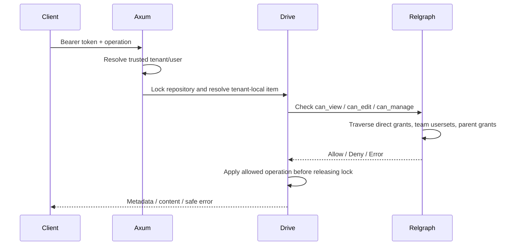

# Drive API

A runnable Rust/Axum project showing how an application manages files and
sharing with Relgraph. It uses a local relationship store and text content so
you can explore the complete flow without a database, cloud account, or an
OpenFGA server. This example is independent of Google and OpenFGA.

## Run

From the repository root:

```sh
cargo run -p drive-api
```

Or from this directory: `cargo run`. The default address is
`http://127.0.0.1:3001`; set `DRIVE_LISTEN_ADDR` to change it. Ctrl-C drains
active requests. Restarting resets metadata, content, and grants.

## Seeded drive and identities

```text
tenant acme
  acme-drive          workspace, owned by Alice
    design-folder    folder, owned by Alice; design team has editor access
      roadmap-file   text file, owned by Alice; inherits folder permissions

tenant other
  other-drive        workspace, owned by Eve
```

| Bearer token | Tenant | Identity | Initial access |
| --- | --- | --- | --- |
| `alice-demo` | acme | alice | Owns the Acme workspace, folder, and file |
| `bob-demo` | acme | bob | Design team member; edits the folder and its files |
| `carol-demo` | acme | carol | No grants |
| `eve-demo` | other | eve | Owns the other tenant's workspace |

The authentication middleware maps these fixed credentials to trusted
identities. Request bodies cannot select a tenant, owner, or resource ID.
Recipients must belong to the authenticated tenant's demo directory.

## Try browsing and editing

Bob can list the items he can view, including the inherited file. His list
does not include the workspace because he has no grant there:

```sh
curl -s -H 'Authorization: Bearer bob-demo' localhost:3001/items
curl -s -H 'Authorization: Bearer bob-demo' \
  'localhost:3001/items?parent_id=design-folder'
curl -s -H 'Authorization: Bearer bob-demo' \
  localhost:3001/items/roadmap-file/content
```

Update the file with its current revision. On a fresh server, this returns
revision 2. Repeating it with `expected_revision: 1` returns `409`:

```sh
curl -i -X PUT -H 'Authorization: Bearer bob-demo' \
  -H 'Content-Type: application/json' \
  -d '{"content":"Design review scheduled for Friday.","expected_revision":1}' \
  localhost:3001/items/roadmap-file/content
```

Bob's inherited edit access does not grant management permission on Alice's
file. Attempting to share it as Bob returns `403`.

## Share and revoke

Carol initially receives `403` on this file:

```sh
curl -i -H 'Authorization: Bearer carol-demo' \
  localhost:3001/items/roadmap-file/content
```

Alice grants Carol viewer access. Save the `id` from the response:

```sh
curl -s -X POST -H 'Authorization: Bearer alice-demo' \
  -H 'Content-Type: application/json' \
  -d '{"grantee":{"kind":"user","id":"carol"},"role":"viewer"}' \
  localhost:3001/items/roadmap-file/shares
```

Carol can now read the file, while editing still returns `403`. Alice can
inspect direct grants and revoke the new share using its returned ID:

```sh
curl -s -H 'Authorization: Bearer alice-demo' \
  localhost:3001/items/roadmap-file/shares

# Replace share-id with the ID returned by POST /shares.
curl -i -X DELETE -H 'Authorization: Bearer alice-demo' \
  localhost:3001/items/roadmap-file/shares/share-id
```

Revocation returns `204`. Carol returns to `403` if she has no other grant.
Deleting a direct share does not revoke another share or inherited access.
To revoke Bob's seeded inherited grant, list `design-folder/shares` as Alice
and delete that team share on the folder. A team share uses
`{"grantee":{"kind":"team","id":"design"},"role":"editor"}`.

## Create folders and files

Alice can create a folder under her workspace:

```sh
curl -s -X POST -H 'Authorization: Bearer alice-demo' \
  -H 'Content-Type: application/json' \
  -d '{"kind":"folder","name":"Finance","parent_id":"acme-drive"}' \
  localhost:3001/items
```

Bob can create a file in the folder he can edit:

```sh
curl -s -X POST -H 'Authorization: Bearer bob-demo' \
  -H 'Content-Type: application/json' \
  -d '{"kind":"file","name":"Notes.txt","parent_id":"design-folder","content":"Review notes"}' \
  localhost:3001/items
```

The creator owns the new item. Ownership lets Bob share his own new file;
Alice retains management access inherited from the ancestor workspace. Parent
editor/viewer grants continue to apply. Workspace provisioning is server-owned.

## Endpoints

| Method | Path | Required permission | Result |
| --- | --- | --- | --- |
| GET | `/health` | Public | Health response |
| GET | `/items?parent_id=…` | View checked per item | Visible metadata only |
| POST | `/items` | Parent `can_edit` | Created folder/file, `201` |
| GET | `/items/{id}` | `can_view` | Metadata |
| GET | `/items/{id}/content` | `can_view` | Text and revision |
| PUT | `/items/{id}/content` | `can_edit` | Updated metadata |
| GET | `/items/{id}/shares` | `can_manage` | Direct grants |
| POST | `/items/{id}/shares` | `can_manage` | Created share, `201` |
| DELETE | `/items/{id}/shares/{share_id}` | `can_manage` | Revoked share, `204` |

Missing/unknown credentials return `401`, denied access returns `403`, absent
or other-tenant resources return `404`, and stale revisions or duplicate
shares return `409`. Application validation returns `400`; Axum's JSON
extractor uses its own rejection statuses for malformed JSON or invalid enum
values. Evaluator/store failures return a safe `503`, with details logged on
the server. JSON request bodies are limited to 128 KiB, file content to 64 KiB,
and names to 200 bytes. Metadata responses omit content and tenant internals.

## How authorization fits the application



- [`authorization.fga`](authorization.fga) defines the permission rules.
- [`src/auth.rs`](src/auth.rs) supplies trusted identities.
- [`src/drive.rs`](src/drive.rs) owns metadata, relationship tuples, and exact
  share removal. It compiles the model at startup and uses default check limits.
- [`src/api.rs`](src/api.rs) maps domain operations to fixed capabilities,
  validates input, and checks revisions.
- [`src/error.rs`](src/error.rs) maps errors to safe HTTP responses.
- [`src/main.rs`](src/main.rs) starts and shuts down the server.

Checks live inside application handlers because creation checks a parent,
listing checks each result, and mutations must stay consistent with their
authorization checks. No API allows callers to write arbitrary tuples.

## Scope and production adaptations

Relgraph currently rejects recursive model dependencies. This example therefore
has exactly three resource levels: workspace → folder → file. Arbitrarily
nested folders require a different model/design or recursive runtime support;
simply adding `folder` to its own parent restriction will not work.

The process-local mutex serializes requests, including authorization checks,
so share revocation and edits have a clear order. It is a teaching implementation,
with an unpaginated catalog and in-memory metadata/content/grants. For larger
systems, use authenticated sessions or verified tokens, a real tenant directory,
durable metadata, object storage, bounded listing/pagination, audit events, and
a consistency strategy for metadata plus relationship writes across processes.
Using the PostgreSQL relationship adapter alone does not make metadata writes
atomic with grants. This example implements neither file moves/deletion nor
uploads, public links, ownership transfer, or Google APIs.

Axum middleware and state follow the [Axum 0.8.9 documentation](https://docs.rs/axum/0.8.9/axum/middleware/index.html).
