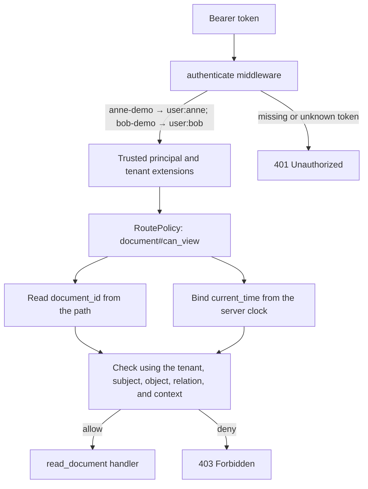

# `relgraph-authz`

`relgraph-authz` compiles an OpenFGA DSL model into a local authorization
runtime. The application provides authentication, relationship tuples, and
explicit mappings from request inputs to condition parameters. The optional
`axum` feature adds a Tower middleware layer for protected routes.

## In-memory quick start

The core crate works without PostgreSQL, Axum, or another external service.
Add `relgraph-authz` and a Tokio runtime to the application, then bind an
in-memory store to a compiled model:

```toml
[dependencies]
relgraph-authz = { version = "0.1", default-features = false }
tokio = { version = "1", features = ["macros", "rt-multi-thread"] }
```

```rust,no_run
use std::error::Error;

use relgraph_authz::{
    CheckRequest, EvaluationLimits, FgaAuthz, InMemoryRelationshipStore,
    ObjectRef, RelationName, RelationshipTuple, Subject, TenantId,
};

const MODEL: &str = r#"
model
  schema 1.1

type user

type document
  relations
    define viewer: [user]
"#;

#[tokio::main]
async fn main() -> Result<(), Box<dyn Error>> {
    let tenant = TenantId::new("acme")?;
    let subject = Subject::new("user", "anne")?;
    let object = ObjectRef::new("document", "42")?;
    let relation = RelationName::new("viewer")?;

    let store = InMemoryRelationshipStore::new();
    store.insert(RelationshipTuple::new(
        tenant.clone(),
        object.clone(),
        relation.clone(),
        subject.clone(),
    ))?;

    let authorizer = FgaAuthz::new(MODEL)?
        .with_store(store, EvaluationLimits::default());
    let request = CheckRequest::new(tenant, subject, object, relation);
    let _decision = authorizer.check(request).await?;
    Ok(())
}
```

The in-memory store is suitable for tests, examples, and small local
deployments. Use a durable adapter such as `relgraph-authz-postgres` when
relationships must be shared across application processes or survive restarts.
The matching crate-level `no_run` example is compile-checked by
`cargo test -p relgraph-authz --doc` without running a Tokio runtime.

## Runnable Axum example

Run the example with:

```sh
cargo run -p relgraph-authz --example axum_authz --features axum
```

It listens on `127.0.0.1:3000`. The example embeds
[`examples/authorization.fga`](examples/authorization.fga), inserts an
unconditional `viewer` tuple for Anne and a 30-minute `time_limited_viewer`
tuple for Bob, then protects `GET /documents/{document_id}` with a policy for
`document#can_view`. Its authentication middleware maps the fixed demo tokens
to trusted `Subject` and `TenantId` extensions; callers cannot select an
arbitrary subject ID.

Try the normal viewer grant:

```sh
curl -i -H 'Authorization: Bearer anne-demo' \
  http://127.0.0.1:3000/documents/42
```

Try Bob's conditional grant while it is active:

```sh
curl -i -H 'Authorization: Bearer bob-demo' \
  http://127.0.0.1:3000/documents/42
```

Both requests return `200 OK`. A subject without a tuple is denied:

```sh
curl -i -H 'Authorization: Bearer anne-demo' \
  http://127.0.0.1:3000/documents/99
```

That request returns `403 Forbidden`; a missing or unrecognized demo token
returns `401 Unauthorized`. The example's hard-coded tokens and in-memory
store are for demonstration. Replace them with the application's authentication
and relationship-store implementations.

### How a request is authorized

The model and demo tuples are prepared once before the listener starts. For
each request, the outer authentication middleware adds the trusted subject and
tenant extensions. The route policy then fixes the authorization check,
extracts the object ID and server time, and asks the store-backed evaluator to
check the model. Only an allow reaches the handler.



Anne's tuple satisfies the `viewer` branch of `can_view` without a condition.
Bob's tuple satisfies `time_limited_viewer` only while the model's
`valid_grant` expression is true. The tuple stores `grant_time` and
`grant_duration`; the route provides `current_time` for that check. The Rust
source and model file contain matching comments beside each setup step.

## Input mapping and tuple ownership

The model defines the possible relationships; it does not grant access by
itself. The example explicitly inserts `(user:anne, viewer, document:42)` and
`(user:bob, time_limited_viewer, document:42)`. A production relationship
store owns and returns these grants. Every tuple is scoped to the trusted
tenant selected by the application; tenant scope is not itself proof of a
relationship.

The route policy fixes `document` and `can_view`, gets the document ID from the
named `document_id` path capture, and obtains the principal and tenant from
authentication extensions. It binds only
`valid_grant.current_time` as request context, using the server's current UTC
time for each check. The conditional tuple stores `grant_time` and
`grant_duration` under the `valid_grant` condition. Tuple context takes
precedence over request context; request bindings can fill missing condition
values but cannot replace stored grant values. The body is not read for
authorization.

For an ordinary route that checks a relation without request-sourced condition
values, the minimum policy is just the principal, tenant, and path object ID:

```rust
struct AuthenticatedPrincipal(Subject);
impl PrincipalIdentity for AuthenticatedPrincipal {
    fn subject(&self) -> &Subject { &self.0 }
}

struct AuthenticatedTenant(TenantId);
impl TenantIdentity for AuthenticatedTenant {
    fn tenant_id(&self) -> &TenantId { &self.0 }
}

let viewer = authz.middleware(
    RoutePolicy::new("document", "viewer")
        .principal(PrincipalSource::extension::<AuthenticatedPrincipal>())
        .tenant(TenantSource::extension::<AuthenticatedTenant>())
        .object_id(ObjectIdSource::path("document_id")),
)?;
let app = Router::new()
    .route("/documents/{document_id}", get(read_document))
    .route_layer(viewer);
```

The runnable example has seven route/demo declarations: these two extension
types and their two identity trait implementations, its authentication
middleware, route handler, and `main`. Four declarations adapt the principal
and tenant; `ObjectIdSource::path` reads Axum's named path capture without an
application-defined path type. The existing authentication middleware inserts
the two trusted extensions before authorization runs. If an application
already defines compatible extension types and identity implementations, it
only needs the policy chain.

Add a `ContextBinding` only when a condition parameter must come from explicit
request or application context. Tuple-stored condition values need no route
binding. The bundled `can_view` demonstration binds `current_time` because its
`valid_grant` condition needs the current time; its grant time and duration are
already stored with the tuple. `ContextValueProvider::from_request_parts` and
`from_async` are for custom synchronous extraction or asynchronous resolution
of those request-context values. Registration checks the declared condition
parameter type, and runtime values are checked again with lossy numeric
conversions rejected.

## Errors and execution limits

`FgaAuthz::new` parses the model, runs semantic and runtime capability checks,
and compiles its conditions before the application starts serving requests.
Construction errors identify invalid or unsupported models. Authorization
middleware responds with:

| Result | HTTP status |
| --- | ---: |
| No matching relationship | `403 Forbidden` |
| Missing authenticated principal | `401 Unauthorized` |
| Invalid path ID or request-bound condition input | `400 Bad Request` |
| Relationship-store failure or exhausted evaluation budget | `503 Service Unavailable` |
| Invalid trusted server state or internal failure | `500 Internal Server Error` |

Authorization errors remain distinct from a normal deny decision. Tuple reads
are processed in pages of at most 128 tuples, further limited by the remaining
tuple budget. Before membership is evaluated, every tuple in the fetched page
must pass ownership, condition-context, and relation-restriction validation.
An invalid tuple or preparation-budget error anywhere in that page defeats a
possible grant from the same page.

After a page passes preparation, tuples are evaluated in returned order. A
successful membership check and any applicable true condition grant access
immediately, so the evaluator does not request a later page. A malformed tuple
or store error that exists only in an unrequested later page cannot defeat that
grant. Without a grant, evaluation continues through the required pages and
propagates a requested store error. A membership or condition evaluation error
can be masked by a later grant; if evaluation reaches the end without a grant,
it returns the first such error or a normal deny. For a corrupt custom store,
the decision can therefore depend on its page boundaries; the evaluator does
not scan later pages as an integrity check. This behavior makes no
upstream-equivalence claim for malformed custom-store results. The protected
handler runs only after an allow.

`EvaluationLimits::default()` bounds each check to 10,000 tuples scanned, 64
relation traversal steps, 1,024 store page reads, 100,000 expression/tuple work
units, and CEL condition cost 100. Applications can configure these limits
when binding a store; the condition-cost limit can be raised up to 100,000.
Condition contexts accepted by the in-memory and PostgreSQL stores are limited to
65,536 serialized JSON bytes and 10,000 collection entries. Evaluation also
accounts for request and custom-store context conversion against the condition
budget.
Tuple, store-call, work, and CEL budgets are shared across nested traversals.
Every tuple in a fetched page counts against the tuple and work budgets, even
when an earlier tuple in that page grants access. Each active traversal holds
at most one tuple page and its prepared metadata, plus bounded cursor history;
parent pages can remain live while nested checks run. Backend snapshot memory
is outside this bound. These local budgets bound this runtime's work and do not
claim to reproduce OpenFGA server CEL cost accounting.

## Construction cost measurements

The parser's construction guards bound three different model shapes: 128
nested parentheses, 512 expression or target units in one relation, and 4,096
declarations across a model. The expression-unit limit constrains the input
shape presented to the recursive compiler; it is not a general compiler-stack
guarantee. The declaration limit bounds model-wide index volume independently
of the per-relation limit.

On the measured macOS Apple M1 host, all ten accepted construction workloads
compiled and dropped in isolated child processes in both debug and release
profiles. This includes a left-deep relation at the 512-unit boundary and
`nested_128`, whose 128 parentheses produce only two expression units. The
`wide_indexes_2047` case compiled a model with 2,047 independent relations and
4,095 declarations; `repeated_128` compiled 128 relations with 512 units each
and 65,409 compiled expressions. These stress results apply to the tested
workloads and host.

Across three release runs, full-construction medians for `union_exact_512`
were 92,375 / 92,666 / 95,333 ns; `wide_indexes_2047` measured
3,445,000 / 3,498,417 / 3,724,417 ns; and `repeated_128` measured
12,193,750 / 12,060,250 / 13,824,417 ns. Their measured whole-process peak
RSS was 9,633,792, 17,383,424, and 233,979,904 bytes, respectively. RSS
includes the test harness, fixture preparation, and all measurement phases;
it is not an index allocation or live evaluator measurement. Linux x86_64 was
not measured, and the workspace declares no MSRV, so these observations make
no general platform-support claim.

The ignored measurement test can be run for the exact-limit union case with:

```sh
RELGRAPH_CONSTRUCTION_COST_CASE=union_exact_512 cargo test -p relgraph-authz --release --lib authz::model::construction_costs::measure_construction_costs -- --ignored --exact --nocapture --test-threads=1
```

See the [construction cost report](../CONSTRUCTION_COSTS.md) for all
workloads, phases, measurements, and limitations. The timings are descriptive
construction observations; they do not set a latency target or claim runtime
authorization speed.

## Supported runtime profile

The runtime supports all six relation-expression forms represented by the
parser, on acyclic relation dependencies. Cyclic or recursive model dependencies
are rejected during construction with an unsupported-recursion diagnostic;
fixed-point recursive evaluation is not implemented. This restriction is
separate from parser acceptance.

The pinned CEL implementation is `cel-core = 0.5.1`. The supported condition
types are `bool`, `int`, `uint`, `double`, `string`, `duration`, `timestamp`,
and one-level `list<T>` or `map<T>` containers over those scalar types (map
keys are strings). Timestamps use RFC3339 and durations use CEL/OpenFGA
duration strings. The expression profile includes boolean, numeric, and string
comparisons and arithmetic; field and index access; `has`, `size`,
`startsWith`, `endsWith`, and `matches`; and scalar/time conversions `int`,
`uint`, `double`, `string`, `bytes`, `duration`, and `timestamp`.

`list.contains(value)` is not supported by the pinned compiler. Bytes as
declared values, `any`, IP addresses, nested containers, custom/message types,
extension functions, and comprehension macros are rejected during model
construction. Parser support for a syntax form does not imply that the local
authorization runtime can execute it.

## Feature checks

The parser crate has no authorization, Axum, or CEL runtime dependency. The
authorization crate's core runtime is available without default features;
Axum integration is enabled explicitly:

```sh
cargo check -p relgraph_dsl --all-targets
cargo test -p relgraph_dsl --all-targets
cargo check -p relgraph-authz --all-targets
cargo test -p relgraph-authz --all-targets
cargo check -p relgraph-authz --all-targets --features axum
cargo test -p relgraph-authz --all-targets --features axum
cargo test --workspace --doc --all-features
```
