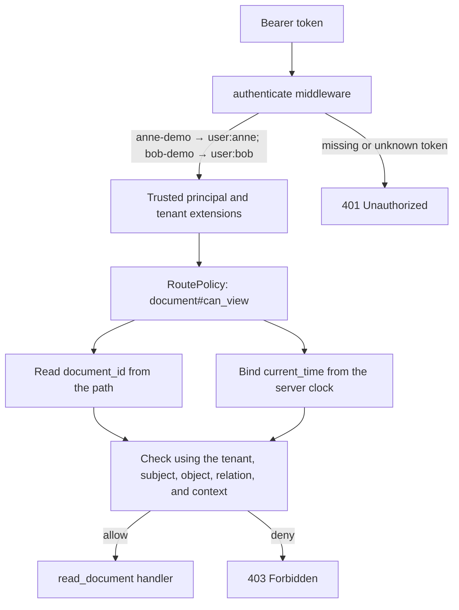

# Runnable Axum example

Run the example with:

```sh
cargo run -p relgraph-authz --example axum_authz --features axum
```

It listens on `127.0.0.1:3000`. The example embeds
[`authorization.fga`](authorization.fga), inserts an
unconditional `viewer` tuple for Anne and a 30-minute `time_limited_viewer`
tuple for Bob, then protects `GET /documents/{document_id}` with a policy for
`document#can_view`. Its authentication middleware maps the fixed demo tokens
to trusted `Subject` and `TenantId` extensions; callers cannot select an
arbitrary subject ID.

Try the normal viewer grant:

```sh
curl -i -H 'Authorization: Bearer anne-demo' \
  http://127.0.0.1:3000/documents/42
```

Try Bob's conditional grant while it is active:

```sh
curl -i -H 'Authorization: Bearer bob-demo' \
  http://127.0.0.1:3000/documents/42
```

Both requests return `200 OK`. A subject without a tuple is denied:

```sh
curl -i -H 'Authorization: Bearer anne-demo' \
  http://127.0.0.1:3000/documents/99
```

That request returns `403 Forbidden`; a missing or unrecognized demo token
returns `401 Unauthorized`. The example's hard-coded tokens and in-memory
store are for demonstration. Replace them with the application's authentication
and relationship-store implementations.

### How a request is authorized

The model and demo tuples are prepared once before the listener starts. For
each request, the outer authentication middleware adds the trusted subject and
tenant extensions. The route policy then fixes the authorization check,
extracts the object ID and server time, and asks the store-backed evaluator to
check the model. Only an allow reaches the handler.



Anne's tuple satisfies the `viewer` branch of `can_view` without a condition.
Bob's tuple satisfies `time_limited_viewer` only while the model's
`valid_grant` expression is true. The tuple stores `grant_time` and
`grant_duration`; the route provides `current_time` for that check. The Rust
source and model file contain matching comments beside each setup step.

